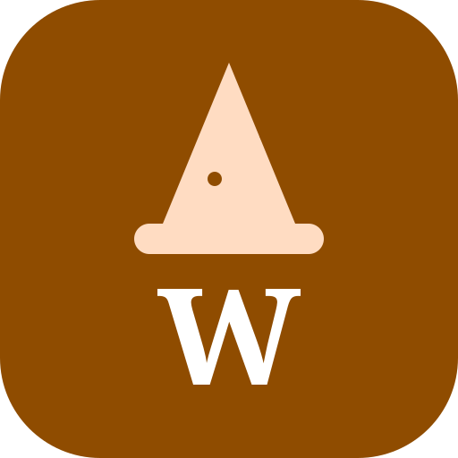
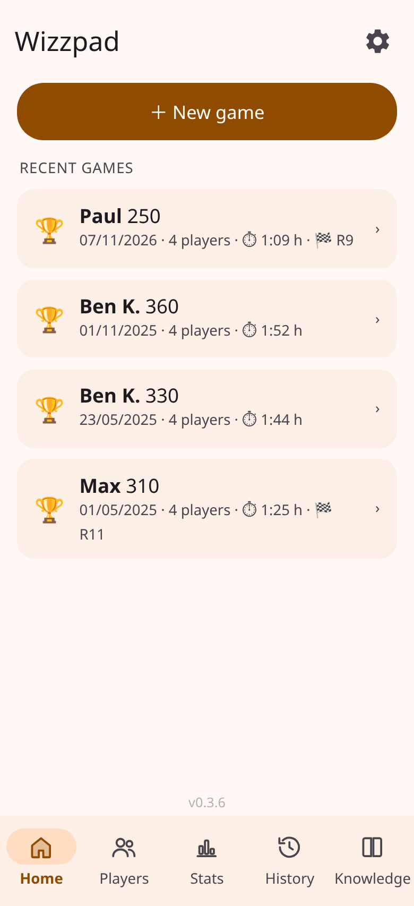
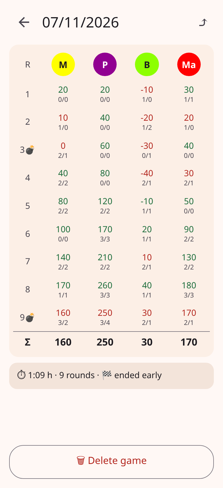
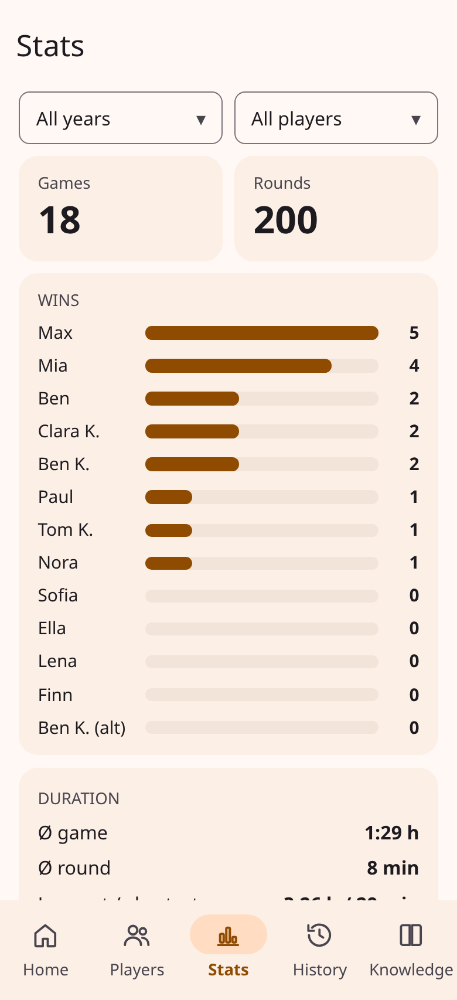

<!-- PROJECT LOGO -->
<br />
<p align="center">
  <a href="https://github.com/fj-gruenewald/wizzpad/">
    
  </a>

  <h3 align="center">Wizzpad</h3>

  <p align="center">
    The ad-free score pad for the card game Wizard – works offline on phone, tablet and PC.
    <br />
    <a href="https://github.com/fj-gruenewald/wizzpad/tree/main/src"> Source Code </a>
    ·
    <a href="https://github.com/fj-gruenewald/wizzpad/issues"> Report Bug </a>
    ·
    <a href="https://github.com/fj-gruenewald/wizzpad/issues"> Request Feature </a>
  </p>
</p>

<!-- ABOUT THE PROJECT -->
## About The Project
[![Contributors][contributors-shield]][contributors-url]
[![Forks][forks-shield]][forks-url]
[![Stargazers][stars-shield]][stars-url]
[![Issues][issues-shield]][issues-url]
[![GPL-3.0 License][license-shield]][license-url] <br/>

  Wizzpad replaces the paper score sheet for Wizard card game nights.
  Enter bids and tricks round by round, and Wizzpad does the math, keeps your history and shows who really is the best fortune teller at the table.

<p align="center">
  
  &nbsp;
  
  &nbsp;
  
</p>

Wizzpad is a Progressive Web App (PWA) built with [Svelte 5](https://svelte.dev/), [Vite](https://vite.dev/) and TypeScript. It runs completely in the browser, needs no account and no backend and stores all data locally on your device. Once installed, it works offline like a native app.

## Installation and Usage

**Use it:** Host the built app on any web server (see below), open it in Chrome on your phone and choose *Install app* / *Add to home screen*.

**Develop it:**

```bash
npm install
npm run dev      # dev server with live reload on http://localhost:5173
npm test         # unit tests for scoring, import and translations
npm run check    # type check
npm run build    # production build in dist/
```

The content of `dist/` is a static website. Any web server works, e.g. an `nginx:alpine` container that serves the folder.

During development the app loads the sample games from `data/` (players with made-up names), so history and statistics are filled.

<!-- ROADMAP -->
## Roadmap

Current Features:
  - Score sheet for up to 6 players with automatic scoring
  - Fast round input for bids and tricks, with dealer and starting player
  - Hidden bids that stay secret until everyone has bid
  - Special cards and house rules such as Bomb, Cloud and your own custom cards
  - Scoreboard and complete history of all games
  - Statistics and player profiles, filterable by year and number of players
  - Import from the Android app *Wizard Block* and from CSV, export as backup
  - Share a game as an image
  - German and English, light and dark theme, several color schemes
  - Tablet layout with round input and scoreboard side by side
  - Keeps the screen awake during a game
  - Built-in rules and card knowledge base

See the [open issues](https://github.com/fj-gruenewald/wizzpad/issues) for a list of proposed features and errors that maybe you can add or fix.

<!-- CONTRIBUTING -->
## Contributing

Do **you** wanna **help** make Wizzpad **better**? <br>
Open an [Issue](https://github.com/fj-gruenewald/wizzpad/issues) or a Pull Request and become a **Contributor**.

<!-- LICENSE -->
## License

Distributed under the GNU General Public License v3.0. See `LICENSE` for more information.

## Disclaimer

Wizzpad is an unofficial fan project and is not affiliated with or endorsed by AMIGO Spiel + Freizeit GmbH. *Wizard* is a trademark of its respective owner. Wizzpad only keeps the score – you still need the cards.

<!-- MARKDOWN LINKS & IMAGES -->
<!-- https://www.markdownguide.org/basic-syntax/#reference-style-links -->
[contributors-shield]: https://img.shields.io/github/contributors/fj-gruenewald/wizzpad.svg?style=for-the-badge
[contributors-url]: https://github.com/fj-gruenewald/wizzpad/graphs/contributors
[forks-shield]: https://img.shields.io/github/forks/fj-gruenewald/wizzpad.svg?style=for-the-badge
[forks-url]: https://github.com/fj-gruenewald/wizzpad/network/members
[stars-shield]: https://img.shields.io/github/stars/fj-gruenewald/wizzpad.svg?style=for-the-badge
[stars-url]: https://github.com/fj-gruenewald/wizzpad/stargazers
[issues-shield]: https://img.shields.io/github/issues/fj-gruenewald/wizzpad.svg?style=for-the-badge
[issues-url]: https://github.com/fj-gruenewald/wizzpad/issues
[license-shield]: https://img.shields.io/github/license/fj-gruenewald/wizzpad.svg?style=for-the-badge
[license-url]: https://github.com/fj-gruenewald/wizzpad/blob/main/LICENSE

<br>
